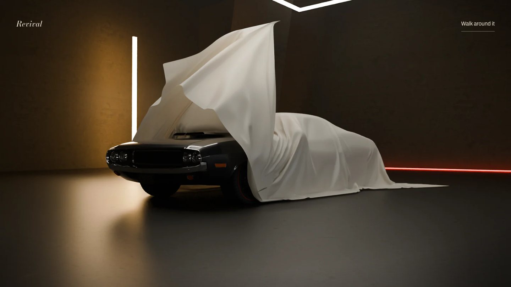
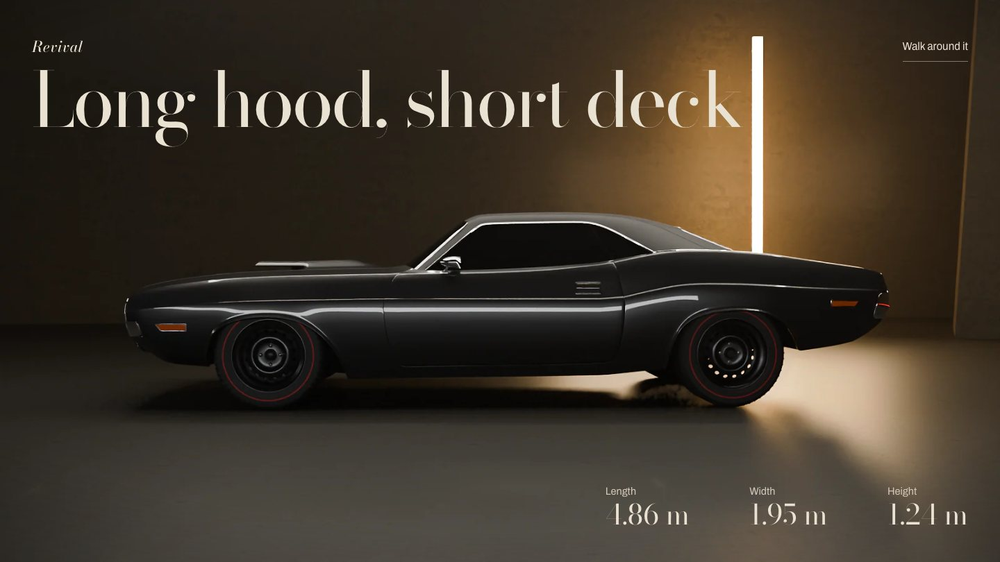
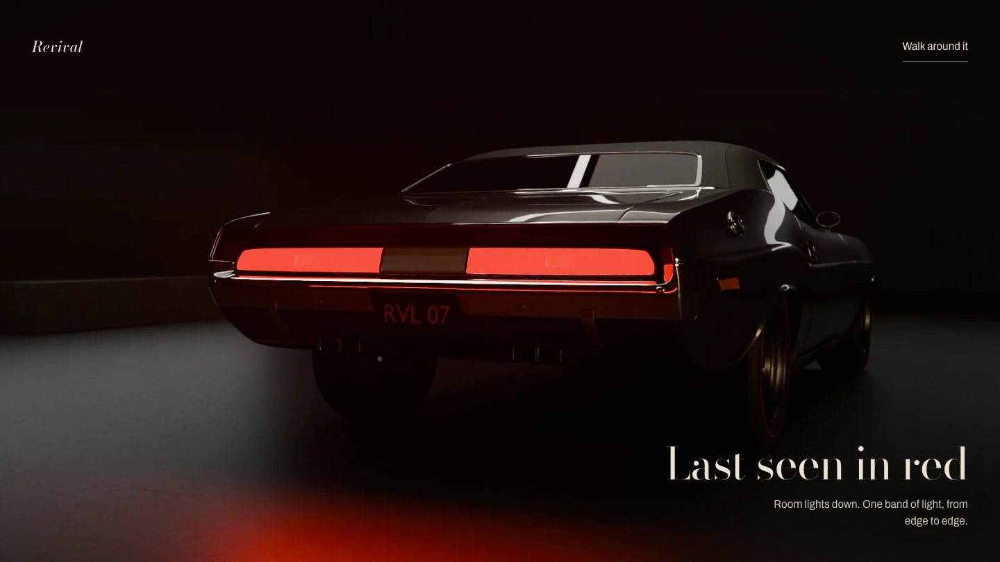
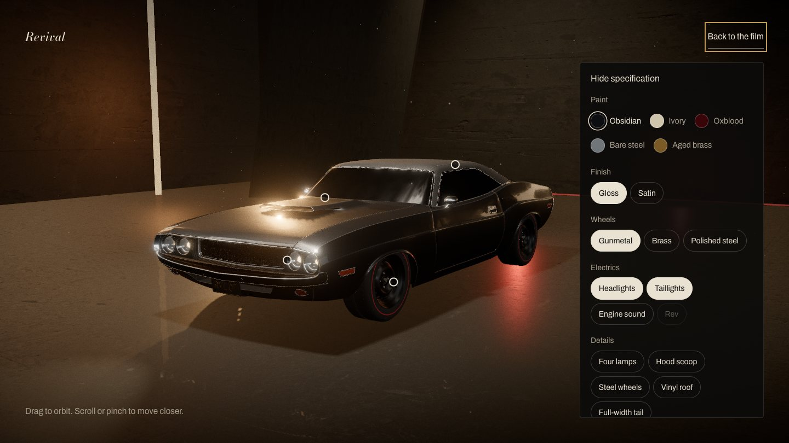
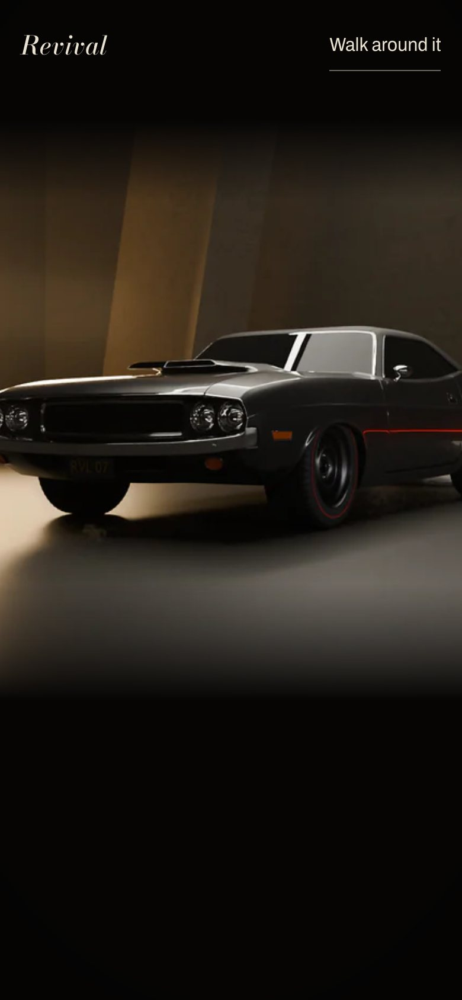

# Revival



An interactive film about one classic muscle car, with a booking system behind it. Scroll to pull 37 m² of silk off it, follow the camera around a dark concrete studio, then step out of the film and walk around the car in realtime: change paint, finish and wheels, switch the lamps, start the engine.

**Live: [madinaza.github.io/revival](https://madinaza.github.io/revival/)**

Revival is a fictional studio and a personal portfolio project. It is not affiliated with or endorsed by any car maker.

## How it works

- **The film** is 320 frames path traced in Blender Cycles, with a real cloth simulation for the silk. They are drawn to a 2D canvas, and scroll position picks the frame. Frames load coarse to fine, so the whole film can be scrubbed early and gets smoother as the rest arrives.
- **The realtime view** is Three.js through React Three Fiber. It loads only when a visitor heads for it, and its opening camera matches the last film frame, so the handover reads as one shot.
- **Why both:** a path-traced film looks like a photograph but cannot be touched, and a realtime scene can be touched but looked like animation when it had to carry the reveal. [docs/ARCHITECTURE.md](docs/ARCHITECTURE.md) records what was tried, measured and dropped.

## Stack

**Site:** React 19, TypeScript, Vite, Three.js, React Three Fiber, zustand, Vitest.
**Backend:** Java 25, Spring Boot 4.2, Spring Security, PostgreSQL 18, Flyway, Testcontainers, Docker Compose. See [docs/BACKEND.md](docs/BACKEND.md).
**Film:** Blender (Python) for the model, cloth, lighting and rendering; sharp and glTF Transform for encoding.

## Run it

Requires a current Node.js release (developed on 26).

```bash
npm install
npm run dev
```

```bash
npm test
npm run build
npm run preview
```

`npm run deploy` builds the site and replaces the `gh-pages` branch with it.

The live site is the static build: the film, the configurator and how it was made, without saving, prices or bookings. The full system adds saved designs with their own page, comparison, a test-drive calendar, a page to move or cancel a booking, and a front desk with calendar, requests, catalogue, summary and history. For the full system, with Docker running:

```bash
npm run setup
```

```bash
docker compose up --build
```

Then open `http://localhost:8090`, and `http://localhost:8090/admin.html` for the front desk. `setup` writes random passwords to `.env`, including the front desk login. Backend tests: `cd backend && ./mvnw test` (Java 25 and Docker).

URL switches for testing: `?tier=high|medium|low` fixes the realtime quality, `?nowebgl` shows the film-only fallback.

## Accessibility and fallbacks

- Every control works from the keyboard, focus moves with the view, and Escape steps back.
- With reduced motion the film holds still and cuts between chapters.
- Without WebGL 2 the film still plays, and Three.js is never downloaded.
- Realtime quality adapts to the measured frame rate. Engine sound is synthesised and off until asked for.

## Measurements

Taken on 25 November 2026 on a MacBook Air (Apple M5, 32 GB, macOS 26.6) with headless Chrome 158 on the GPU, against a local production build. The phone column is Chrome's phone emulation on the same Mac, not a phone. The display refresh limits both to 60 fps.

| | Desktop 1440 × 810 | Phone emulation 390 × 844 |
|---|---|---|
| Frame interval while scrubbing the film (median / p95 / worst) | 16.7 / 16.8 / 16.8 ms | 16.7 / 16.7 / 16.8 ms |
| Frame interval in the realtime view (median / p95 / worst) | 16.7 / 18.6 / 18.9 ms | 16.7 / 18.1 / 18.7 ms |
| Realtime draw calls / triangles per frame, all passes | 130 / 1.23 M | 75 / 0.62 M |
| Realtime quality tier, pixel ratio | high, 1 | medium, 1 |
| Entering the realtime view | 1.4 s | 1.3 s |
| Film download, all 320 frames | 12.5 MB | 6.1 MB |
| Console errors, horizontal overflow | none | none |

First frame appeared in 80 to 140 ms locally. On the live GitHub Pages site, over one home connection of unmeasured speed and a cold cache, one run each showed the first frame after 0.43 s (desktop) and 0.61 s (phone emulation), and the complete film after 8.6 s and 8.4 s; it can be scrubbed before that. The same checks pass there. Initial JavaScript is 76 KB gzipped; Three.js and the scene add 395 KB gzipped and the car model 1.6 MB, only when a visitor heads for the realtime view.

Automated checks: 22 of 22 pass, including axe (WCAG 2 A/AA, 2.1 AA, 2.2 AA rules) with no violations in the film, the realtime view and the fallback. Axe could not judge the contrast of text over imagery; that was reviewed by eye. 14 of 14 unit tests pass.

Not tested: real phones, Safari, Firefox, screen readers, slow networks.

Reproduce against `npm run preview`, with Google Chrome installed and `PW` pointing to a [playwright-core](https://www.npmjs.com/package/playwright-core) package:

```bash
PW=/path/to/playwright-core node tools/capture.mjs shots
PW=/path/to/playwright-core node tools/audit.mjs http://localhost:4173/ shots
```

`capture.mjs` takes the screenshots and frame timings and writes `shots/report.json`. `audit.mjs` runs axe and checks the keyboard, reduced-motion and fallback behaviour. Automated accessibility checks do not replace testing with assistive technology.

## Screenshots and demo video

| | |
|---|---|
|  |  |
|  |  |

To record a 49 second demo, without sound (needs ffmpeg; the film part is stepped through frame by frame and the realtime part is captured live):

```bash
PW=/path/to/playwright-core node tools/demo.mjs demo.mp4
```

To record by hand on macOS, including the engine sound: press Shift-Command-5, record the browser window, scroll slowly from top to bottom, then walk around the car.

## Rebuild the film

Needs Blender 5.2 and the source model named in [docs/ASSETS.md](docs/ASSETS.md). Run in order from the project root, where `blender` is your Blender binary:

```bash
blender -b --factory-startup -P blender/car.py
```

```bash
blender -b --factory-startup -P blender/cloth.py
```

```bash
blender -b --factory-startup -P blender/film.py -- "$PWD/render/film" 0-319 100 96
```

```bash
node tools/encode_film.mjs render/film 86
```

`blender/stills.py` photographs the specifications for the car pages, and `tools/camera_path.py` writes the camera path shown on the making-of page.

Frames that already exist are skipped, so an interrupted render can be resumed. Expect hours, not minutes.

## Credits and licences

Car model: "Dodge Challenger 1970" by Artem P, [CC BY 4.0](https://creativecommons.org/licenses/by/4.0/), modified. Concrete textures: Poly Haven, CC0. Fonts: Bodoni Moda and Archivo, SIL OFL 1.1. Full list: [docs/ASSETS.md](docs/ASSETS.md).

